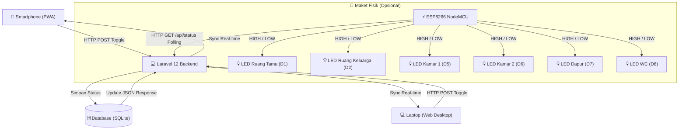

# 🏠 Smart Maket IoT - Simulator Miniatur Rumah Pintar (6 Ruangan)

[](https://laravel.com)
[](https://www.php.net)
[](https://web.dev/progressive-web-apps/)
[](https://arduino.cc)
[](https://sqlite.org)

**Smart Maket IoT** adalah aplikasi simulator dan pengendali rumah pintar (*smart home*) berbasis web dan **Progressive Web App (PWA)** yang dirancang khusus untuk projek/tugas sekolah. Aplikasi ini menyimulasikan maket miniatur rumah 6 ruangan yang masing-masing memiliki 1 lampu kendali mandiri dan dapat dioperasikan secara *real-time* baik dari laptop maupun smartphone.

---

## 📌 Daftar Isi
1. [Tentang Projek](#-tentang-projek)
2. [Fitur Utama](#-fitur-utama)
3. [Teknologi yang Digunakan](#-teknologi-yang-digunakan)
4. [Blueprint & Pemetaan Pin Hardware](#-blueprint--pemetaan-pin-hardware)
5. [Cara Kerja Sistem](#-cara-kerja-sistem)
6. [Panduan Instalasi & Menjalankan](#-panduan-instalasi--menjalankan)
7. [Cara Mengakses Lewat HP (PWA)](#-cara-mengakses-lewat-hp-pwa)
8. [Program Arduino / ESP8266](#-program-arduino--esp8266)

---

## 📖 Tentang Projek

Projek ini dibuat sebagai media peraga pembelajaran Internet of Things (IoT) pada jenjang sekolah. Miniatur rumah terdiri dari **6 ruangan utama**, di mana setiap ruangan dilengkapi **1 buah lampu LED** yang terhubung ke pin mikrokontroler.

Sistem dirancang fleksibel:
- **Mode Simulator Standalone:** Berjalan 100% tanpa hardware fisik untuk presentasi di kelas / laptop penguji.
- **Mode Hardware Nyata:** Terintegrasi langsung dengan mikrokontroler (ESP8266 NodeMCU / ESP32) melalui REST API HTTP JSON.

---

## ✨ Fitur Utama

- 📐 **Denah Miniatur Rumah 2D Arsitektural (Live SVG):**
  Denah interaktif bergaya maket arsitektur lengkap dengan perabotan (kasur, meja nakas, sofa sudut, meja tamu, *kitchen set*, wastafel, kompor, toilet, dan teras).
- 💡 **Efek Pencahayaan Volumetrik Realistis:**
  Saat lampu menyala, ruangan memancarkan cahaya keemasan hangat (*radial glow*) yang menyinari lantai dan furnitur. Ruangan dapat diklik langsung di denah untuk saklar.
- 💻📱 **Dual Mode Interface (Desktop & Mobile):**
  - **Versi Desktop:** Layout 2-kolom layar lebar di laptop lengkap dengan denah maket besar, panel kontrol, dan tabel status pin hardware.
  - **Versi Mobile (PWA):** Tampilan 1-kolom *thumb-friendly* yang nyaman dioperasikan satu jempol di layar HP.
  - Dilengkapi tombol *Mode Switcher* di navigasi untuk beralih mode kapan saja.
- ⚡ **Saklar Master (One-Touch):**
  Tombol cepat *"Nyalakan Semua (6 Lampu)"* dan *"Matikan Semua"*.
- 📲 **PWA & Haptic Feedback:**
  Dapat dipasang ke layar utama HP (*Add to Home Screen*) menjadi aplikasi fullscreen, dilengkapi efek getar HP (*haptic vibration*) dan audio klik saklar sintetis.
- 🔌 **REST API Siap Pakai:**
  Endpoint `/api/status` menghasilkan data JSON ringkas yang mudah diparsing oleh modul ESP8266.

---

## 🛠 Teknologi yang Digunakan

| Komponen | Teknologi | Deskripsi |
| :--- | :--- | :--- |
| **Backend Framework** | [Laravel 12.x](https://laravel.com) | Framework PHP modern untuk routing, MVC, dan REST API. |
| **Bahasa Pemrograman** | [PHP 8.2+](https://php.net) | Bahasa backend server. |
| **Database** | [SQLite](https://sqlite.org) / MySQL | Database penyimpanan status saklar & riwayat aktivitas (Zero-config). |
| **Frontend View** | Laravel Blade | Templating engine dinamis. |
| **Styling UI** | Pure CSS3 (Modern Glassmorphism) | Dark theme bernuansa futuristik, responsif dengan CSS Grid & Flexbox tanpa dependensi berat. |
| **Tipografi & Ikon** | Google Fonts & FontAwesome 6 | Font Outfit & Plus Jakarta Sans dengan ikon FontAwesome 6. |
| **Visual Maket** | Scalable Vector Graphics (SVG) | Denah vektor beresolusi tinggi dengan filter glow & SVG gradients. |
| **Mobile & PWA** | Web App Manifest & Service Worker | Mendukung instalasi aplikasi mandiri dan *offline fallback*. |
| **Web Browser APIs** | Web Audio API & Vibration API | Audio synthesizer klik saklar & getaran haptic pada smartphone. |
| **Hardware IoT** | ESP8266 NodeMCU / ESP32 | Mikrokontroler penghubung LED maket fisik (opsional). |

---

## 🗺 Blueprint & Pemetaan Pin Hardware

### Denah Tata Letak 6 Ruangan

```text
+-----------------------------------+-----------------------------------+
|              KAMAR 1              |              KAMAR 2              |
|        [💡 Pin D5 / GPIO14]       |        [💡 Pin D6 / GPIO12]       |
+-----------------------------------+-----------------+-----------------+
|          RUANG KELUARGA           |      DAPUR      |       WC        |
|        [💡 Pin D2 / GPIO4]        | [💡 Pin D7/G13] | [💡 Pin D8/G15] |
+-----------------------------------+-----------------+-----------------+
|                     RUANG TAMU & TERAS UTAMA                          |
|                        [💡 Pin D1 / GPIO5]                            |
+-----------------------------------------------------------------------+
```

### Tabel Pemetaan Pin (ESP8266 NodeMCU)

| No | Ruangan | Nama Komponen | Pin Board | GPIO | Logika Aktif |
| :---: | :--- | :--- | :---: | :---: | :---: |
| 1 | 🛋️ **Ruang Tamu & Teras** | LED Ruang Tamu | **D1** | GPIO5 | HIGH (3.3V) |
| 2 | 📺 **Ruang Keluarga** | LED Ruang Keluarga | **D2** | GPIO4 | HIGH (3.3V) |
| 3 | 🛏️ **Kamar 1** *(Utama)* | LED Kamar 1 | **D5** | GPIO14 | HIGH (3.3V) |
| 4 | 🛏️ **Kamar 2** *(Anak)* | LED Kamar 2 | **D6** | GPIO12 | HIGH (3.3V) |
| 5 | 🍳 **Dapur** | LED Dapur | **D7** | GPIO13 | HIGH (3.3V) |
| 6 | 🚿 **WC / Kamar Mandi** | LED WC | **D8** | GPIO15 | HIGH (3.3V) |

---

## ⚙️ Cara Kerja Sistem



### Penjelasan Alur:
1. **Perintah Pengguna:** Pengguna menyentuh saklar lampu di HP (PWA) atau mengklik ruangan pada denah laptop.
2. **Pemrosesan Backend:** Request dikirim melalui endpoint `/api/lampu/{id}/toggle`. Server memperbarui status di database dan mencatat riwayat ke tabel log aktivitas.
3. **Pembaruan Visual:** Denah maket SVG langsung berpijar kuning terang di layar laptop berkat sistem sinkronisasi telemetri 2,5 detik.
4. **Respon Hardware (ESP8266):** Mikrokontroler melakukan *polling* ke `/api/status` setiap 1 detik. Jika nilai `ruang_tamu == 1`, pin D1 mengeluarkan tegangan HIGH sehingga lampu LED pada maket menyala seketika.

---

## 🚀 Panduan Instalasi & Menjalankan

### 1. Clone Repository
```bash
git clone https://github.com/kyra-14/smarthome.git
cd smarthome
```

### 2. Install Dependensi PHP
```bash
composer install
```

### 3. Konfigurasi Environment (.env)
Salin berkas konfigurasi bawaan:
```bash
cp .env.example .env
php artisan key:generate
```

Pastikan pada file `.env` menggunakan SQLite:
```env
DB_CONNECTION=sqlite
```

### 4. Migrasi & Seeder Database
```bash
php artisan migrate --force
php artisan db:seed --force
```

### 5. Jalankan Server Lokal
Jalankan server dengan host `0.0.0.0` agar bisa diakses oleh smartphone dalam satu jaringan Wi-Fi:
```bash
php artisan serve --host=0.0.0.0 --port=8000
```
Buka di browser laptop: **[http://127.0.0.1:8000](http://127.0.0.1:8000)**

---

## 📲 Cara Mengakses Lewat HP (PWA)

1. Sambungkan laptop dan smartphone Anda ke **jaringan Wi-Fi / Hotspot yang sama**.
2. Cari tahu alamat IP laptop Anda:
   - Buka CMD/Terminal di laptop, ketik: `ipconfig`
   - Lihat bagian **IPv4 Address** (contoh: `192.168.1.15`).
3. Buka browser di HP (Chrome / Safari), lalu ketik:
   ```text
   http://[IP-LAPTOP]:8000
   ```
   *(Contoh: `http://192.168.1.15:8000`)*
4. **Install Aplikasi PWA:**
   - **Android (Chrome):** Tap ikon titik tiga di kanan atas ➔ pilih **"Tambahkan ke Layar Utama" (Add to Home Screen)**.
   - **iPhone (Safari):** Tap ikon Share di navigasi bawah ➔ pilih **"Add to Home Screen"**.
5. Aplikasi akan terbuka mandiri secara *fullscreen* layaknya aplikasi dari toko aplikasi.

---

## 💻 Program Arduino / ESP8266

Gunakan kodingan berikut pada **Arduino IDE** untuk mikrokontroler **ESP8266 NodeMCU**:

```cpp
#include <ESP8266WiFi.h>
#include <ESP8266HTTPClient.h>
#include <ArduinoJson.h>

// Konfigurasi Wi-Fi & URL Server
const char* ssid = "NAMA_WIFI_ANDA";
const char* pass = "PASSWORD_WIFI";
const char* serverUrl = "http://IP_KOMPUTER_ANDA:8000/api/status";

// Definisi 6 Pin LED untuk 6 Ruangan
#define LED_RUANG_TAMU     D1 // GPIO5
#define LED_RUANG_KELUARGA D2 // GPIO4
#define LED_KAMAR_1        D5 // GPIO14
#define LED_KAMAR_2        D6 // GPIO12
#define LED_DAPUR          D7 // GPIO13
#define LED_WC             D8 // GPIO15

void setup() {
  Serial.begin(115200);

  pinMode(LED_RUANG_TAMU, OUTPUT);
  pinMode(LED_RUANG_KELUARGA, OUTPUT);
  pinMode(LED_KAMAR_1, OUTPUT);
  pinMode(LED_KAMAR_2, OUTPUT);
  pinMode(LED_DAPUR, OUTPUT);
  pinMode(LED_WC, OUTPUT);

  WiFi.begin(ssid, pass);
  Serial.print("Menghubungkan ke WiFi");
  while (WiFi.status() != WL_CONNECTED) {
    delay(500);
    Serial.print(".");
  }
  Serial.println("\nWiFi Terhubung! IP: " + WiFi.localIP().toString());
}

void loop() {
  if (WiFi.status() == WL_CONNECTED) {
    WiFiClient client;
    HTTPClient http;
    http.begin(client, serverUrl);
    int httpCode = http.GET();

    if (httpCode == 200) {
      String payload = http.getString();
      StaticJsonDocument<512> doc;
      deserializeJson(doc, payload);

      digitalWrite(LED_RUANG_TAMU,     doc["ruang_tamu"]     == 1 ? HIGH : LOW);
      digitalWrite(LED_RUANG_KELUARGA, doc["ruang_keluarga"] == 1 ? HIGH : LOW);
      digitalWrite(LED_KAMAR_1,        doc["kamar_1"]        == 1 ? HIGH : LOW);
      digitalWrite(LED_KAMAR_2,        doc["kamar_2"]        == 1 ? HIGH : LOW);
      digitalWrite(LED_DAPUR,          doc["dapur"]          == 1 ? HIGH : LOW);
      digitalWrite(LED_WC,             doc["wc"]             == 1 ? HIGH : LOW);
    }
    http.end();
  }
  delay(1000); // Polling setiap 1 detik
}
```

---

## 👨‍💻 Kontributor
- **Author:** [kyra-14](https://github.com/kyra-14)
- **Tujuan:** Projek Tugas Sekolah - Simulasi Miniatur Maket Rumah Pintar IoT

---

## 📄 Lisensi
Projek ini bersifat open-source di bawah lisensi [MIT License](LICENSE).
